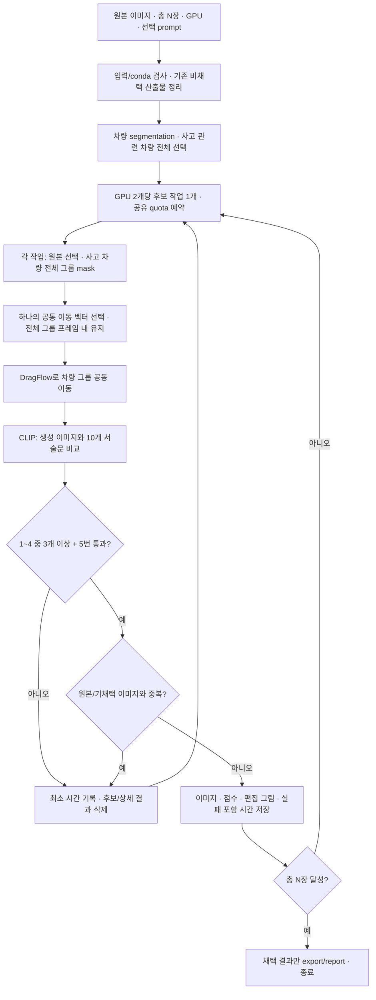

# ADVV 구현 명세

- 문서 버전: **0.10**, 갱신일: **2026-10-11**
- 실행 schema: **2.0** — 기존 VQA schema 1.1 run과 재개 호환되지 않음
- 상태: **v0.4.0에 전체 사고 차량 선택·공동 이동 입력·시각화·진단을 구현했다.** CPU 계약과 실제 image1의 CPU 선택은 확인했으며, 새 경로의 GPU 생성 품질은 미검증이다.
- 프로젝트 이름 ADVV 유지. 기존 풀네임의 VQA는 초기 방법을 가리킨다.

## 1. 목표와 확정 사항

자율주행 자동차 연구에 사용할 **차량 사고 블랙박스 단일 프레임 이미지**를 DragFlow로 증강한다. 이동 대상은 **사고에 직접 관련된 모든 차량**이며, 이들을 한 그룹으로 묶어 같은 방향·거리로 이동한다. 사람·파편·도로·건물과 사고에 무관한 차량은 이동 대상에서 제외한다. 1차 목표는 사고 의미와 시각적 개연성을 유지하는 이미지 증강 파이프라인이다. 후속 모델 성능 개선은 이후 평가한다. 정답 라벨은 필수가 아니며 영상·연속 프레임 생성은 범위 밖이다.

| 항목 | 확정 요구 |
| --- | --- |
| 수량 | 전체 입력에서 새 고유 이미지 총 N장; 원본 제외 |
| 시작점 | 사고 차량 그룹 이동을 나타내는 기준점; 요청/실제 backend 기준점 구분 |
| 도착점 | 전체 그룹이 화면 안에 남는 범위에서 공통 이동 벡터를 무작위 선택 |
| range | 사고 차량 전체 mask의 측정 면적; 무작위 부분 크기 선택 폐기 |
| area | 사고 관련 차량 전체 mask의 합집합; 떨어진 성분과 빈 공간 보존 |
| 생성 지시 | 선택적 `run --prompt`; 생략 시 기본값 |
| 검증 | CLIP 영어 서술문 5쌍, 총 10개 |
| 채택 규칙 | 1–4번 중 3개 이상 통과 **그리고** 5번 필수 |
| 반복 | 목표 달성 또는 사용자 중단까지; 정상 탈락에 총 상한 없음 |
| 탈락 결과 | 기존 비채택 결과 포함 정리; 이미지·상세 결과 비보존 |
| 비용 | 시도별 시간 + 앞선 실패 포함 채택 이미지 획득 시간 |
| 환경 | coordinator/segmenter/DragFlow/CLIP 모두 conda `ADVV` |
| GPU | 2개씩 묶어 병렬 후보 처리; 전체 합계 N장 공유 |
| 기본 경로 | 입력 assets/inputs, 결과 assets/outputs/<run_id>, 설정 configs/advv.clip.local.yaml |

CLIP은 이미지와 문장의 적합도를 비교한다. 답변을 생성하는 VQA가 아니며 물리 법칙의 충족이나 원본 사고 유형의 동일성을 보증하지 않는다. 정상 주행과 사고의 구분도 독립적인 사람 평가가 필요하다.

## 2. 전체 흐름과 채택 조건



오류·사용자 중단은 별도 상태 전이다. 모든 단계에서 중단 시 worker를 종료하고 cursor·최소 시간·정리 상태를 저장한다. 입력 불가·모델 로드 실패·저장소 오류 등은 명시적인 기술 실패로 중단할 수 있다.

```python
# 판정 로직 요약 — 실제 구현은 src/advv/verifiers/decision.py
scores = cosine_similarity(candidate_image, ten_fixed_captions)
require_all_ten_finite(scores)
passed = [scores[i].preferred > scores[i].undesired for i in range(5)]
verification_passed = sum(passed[:4]) >= 3 and passed[4]
accepted = verification_passed and unique_pixels and durable_artifacts_saved
```

5번이 실패하면 1–4번이 모두 통과해도 탈락한다. 1–4번 중 두 항목만 통과하면 5번이 통과해도 탈락한다. 유효 점수의 32가지 Boolean 조합 중 5가지가 검증 통과다. 저장이 끝나지 않은 이미지는 N에 포함하지 않는다.

## 3. CLIP 문장과 점수 계약

실제 문장 원본은 [clip_criteria_v1.json](prompts/clip_criteria_v1.json)이다. 아래 A/B 순서를 고정한다. 영어 문장은 CLIP 입력이고 한국어는 사용자를 위한 설명이다.

| 번호 | 기준 | A: 탈락 상태 (`undesired`) | B: 선호 상태 (`preferred`) |
| --- | --- | --- | --- |
| 1 | 지면과의 관계 | A dashcam image of a vehicle or person floating unnaturally above the road without visible support. | A dashcam image of a vehicle or person naturally supported by the road surface. |
| 2 | 크기와 원근감 | A dashcam image of a vehicle or person that appears excessively large or small for its distance and surroundings. | A dashcam image of a vehicle or person at a realistic scale for its distance and surroundings. |
| 3 | 도로와의 정렬 | A dashcam image of a vehicle positioned at an unnatural angle and location relative to the road layout. | A dashcam image of a vehicle positioned naturally along the road and aligned with its layout. |
| 4 | 물체 간 겹침 | A dashcam image of objects unnaturally fused through one another, with distorted and tangled boundaries. | A dashcam image of distinct objects with clear boundaries and natural occlusion between them. |
| 5 | 사고 의미 | A dashcam image of a normal traffic scene with vehicles traveling along the road. | A dashcam image of a road traffic accident involving one or more vehicles. |

**5번의 한국어 의미: “정상적으로 차량이 통행하는 장면”보다 “한 대 이상의 차량이 관련된 교통사고 장면”에 더 가까운가?** 추돌에 한정하지 않는 일반 사고 기준이다. 원본과 후보를 직접 비교하는 항목은 아니므로 사고 유형·피해 규모·차량 정체성의 정확한 보존을 검사했다고 표시하지 않는다.

```text
v = image_embedding / ||image_embedding||₂
t = text_embedding / ||text_embedding||₂
score(image, text) = dot(v, t)          # raw cosine; 확률이 아님
margin_i = score(B_i) - score(A_i)
pass_i = margin_i > 0                  # 동점은 실패, 초기 threshold=0
```

- float32로 정규화·내적하고 0-norm/NaN/Inf/누락/길이 불일치를 검증 오류로 처리한다. 오류를 허용된 한 개의 실패로 바꾸지 않는다.
- 10개 점수를 모두 구한다. softmax 확률, logit scale, 가중 합산, 절대 점수 threshold, crop 추가 판정을 기본 규칙에 섞지 않는다.
- 구현한 기준 모델은 기존 lock의 로컬 `openai/clip-vit-large-patch14`다. revision은 `configs/upstream.lock.json`의 `32bd64288804d66eefd0ccbe215aa642df71cc41`을 사용한다. **실제 CPU forward는 확인했으며 사고 판정 품질은 미검증**이다. DragFlow 보조 모델의 설치 여부와 verifier 완료를 혼동하지 않는다.
- CLIP 모델/processor revision, resize·padding·crop 정책, normalization, tokenization과 문장 hash를 run에 고정한다. 기본 전처리 설계는 종횡비를 유지해 전체 프레임을 정사각형에 letterbox하는 것이다. center crop으로 사고 주변부를 버리지 않는다. 입력 크기는 고정 vision config의 224×224, resize는 bicubic, padding은 RGB (127,127,127)이며 processor normalization을 적용한다. 조용한 text truncation은 허용하지 않는다.
- 사용자 `--prompt`나 원본 설명은 10문장에 추가하지 않는다. 텍스트 embedding은 같은 모델·전처리·문장 hash 기준으로만 재사용한다.
- 실제 사고에는 차량 부양·전복·비정상 방향·심한 파손이 있을 수 있다. 1·3·4번이 드문 실제 사고를 오배제할 수 있고 CLIP의 관계 구분도 틀릴 수 있다. 현재 규칙을 임의로 완화하지 말고 평가의 한계로 남긴다.

## 4. 입력과 선택 `--prompt`

원본은 저장소의 `assets/inputs`에 넣는다. CLI 필수 인자는 양의 정수 N(또는 설정값)과 사용 GPU이며 `--input-dir`는 제거한다. `--config`는 선택사항이고 cwd와 무관하게 저장소 `configs/advv.clip.local.yaml`로 자동 매핑한다. 결과 기본 경로는 `assets/outputs/<run_id>`이며 `--run-id` 생략 시 고유 이름을 자동 생성한다. 기존 `run N`과 `--target-count N` 형식을 유지하되 동시 지정은 거부한다. 새 run에서 CLI 수량이 없으면 설정값을 사용한다. 재개 시 N·prompt 등 recipe를 변경할 수 없다.

폴더는 안정된 순서로 읽고 EXIF 방향 정규화·RGB 변환·픽셀 hash를 적용한다. 다중 프레임 파일은 단일 프레임 이미지로 자동 간주하지 않는다. 원본은 읽기 전용으로 유지하고 새로운 run의 snapshot을 만든다.

`run/preflight --image image1.png`를 선택적으로 지원한다. `dataset.input_dir` 기준 상대 파일 경로(확장자 포함)이며 CLI > YAML `dataset.image` > 전체 폴더 순서다. 선택 시 해당 이미지 하나만 decode·snapshot·segmentation·증강 대상으로 사용하고 다른 파일은 읽지 않는다. 선택은 recipe에 고정하며 재개에 새 `--image`를 주면 거부한다. 파일 누락/미지원 형식/디렉터리/외부 경로·symlink 탈출은 기존 run 정리나 모델 preflight 전에 오류로 처리하며 전체 폴더로 대체하지 않는다. manifest 입력과 파일 선택을 혼용하여 split/label 계약을 우회하지 않는다.

| 계약 | 목표 동작 |
| --- | --- |
| CLI | `advv run N … --prompt "원하는 증강 설명"` |
| 선택성 | 생략 가능, 생략 시 기본 사고 장면 지시 |
| 우선순위 | CLI `--prompt` → 설정 `generation.augmentation_prompt` → 기본 지시 |
| 빈 입력 | 명시한 빈 문자열/공백만 있는 값은 추론 전 오류 |
| 저장 | 원문·실제 생성 prompt·hash를 실행 설정과 채택 기록에 저장 |
| 적용 범위 | DragFlow target prompt 구성; CLIP 기준·무작위 점·mask 크기 분포를 변경하지 않음 |
| 재개 | `--prompt`를 다시 받지 않고 저장된 값을 사용; 변경하려면 새 run |
| 보안 | 문자열 데이터로 전달; shell/eval/파일 경로로 해석하지 않음 |

기본 source prompt는 입력 도메인을 나타내는 고정 사고 장면 설명으로 시작하며, 선택적인 원본 설명(`preserve_hint`)이 있으면 출처를 구분해 반영한다. target prompt는 같은 사고 맥락, 실제 operation, 선택 증강 지시를 조합한다. 임의 자연어를 좌표 제약으로 변환하거나 자동 번역하는 기능은 기본 계약에 포함하지 않는다. 사용자 지시는 soft conditioning이며 사고 보존이나 원하는 위치 도달을 보증하지 않는다.

**새 경로에는 Qwen SourceProfile과 자동 원본 캡셔닝을 필수 단계로 두지 않는다.** 기본 문장이 개별 원본의 세부 내용을 모두 설명하지 못하는 것은 알려진 제약이다. 추후 별도 captioner가 필요해지면 모델과 비용을 명시해 설계를 갱신한다.

Source는 `source_id`, 입력 경로·hash, 정규화 크기, `group_id`, `split`, `preserve_hint`를 가진다. 폴더 입력은 `source` split을 기본으로 하고 `source/train`만 증강한다. `val/test` 및 split 간 같은 group/내용의 누수는 차단한다. 같은 사고·촬영 영상의 프레임은 같은 group으로 묶어야 하며, source별 임시 group만으로 실제 독립성이 확보되었다고 주장하지 않는다.

## 5. 사고 관련 차량 전체의 공동 이동

### 5.1 사고 차량 선택

1. 원본에서 차량별 instance mask를 얻는다. 검출 차량과 사고 관련 차량은 같은 집합이 아니다.
2. 사고 관련 차량 선택 단계에서 사고에 직접 관여한 차량 ID를 **전부** 선택한다. 추돌·측면 충돌·연쇄 사고·단독 전복/충돌 등 사고 형태를 추돌로 한정하지 않는다. 일반 통행/주차 차량, 구경하는 사람, 도로와 건물은 포함하지 않는다. 파편도 이번 이동 대상에 포함하지 않는다.
3. 자동 선택을 기본 목표로 유지한다. 단순히 모든 차량을 합치거나 가장 큰 차량·가까운 차량을 골랐다는 이유만으로 사고 차량을 찾았다고 표시하지 않는다. 기존 Mask R-CNN은 vehicle instance mask 후보를 주는 모듈이고 사고 관련성 판별기는 아니다.
4. `clip_contact_context_v1`을 source selector baseline으로 사용한다. 고정 Mask R-CNN의 차량 전체 mask에 겹침/8방향 접촉 그래프를 만들고 연결된 차량을 관계 평가 단위로 묶는다. 최대 면적/최단 거리 선택은 하지 않는다. 단독 차량은 별도 단위로 남긴다. 각 단위의 전체 mask cutout(나머지 회색)과 bbox 각 변에 크기의 25%를 더한 주변 맥락 crop을 만든다. 두 view 모두 사고 caption cosine > 정상 caption cosine일 때 구성 차량들을 선택한다. 단독/접촉 그룹용 영어 2쌍은 `prompts/accident_vehicles_v1.json`에 고정하고, scorer는 후보 verifier와 같은 로컬 CLIP revision/letterbox를 사용한다. contact 그룹의 dilation은 인접성 조회에만 쓰며 객체 mask를 늘리지 않는다.
   - 선택 결과·관계 단위·view별 점수·구성 ID·각 mask/hash·그룹 mask/hash·설정/문장/model revision hash를 원본별 cache에 기록한다.
   - 0점 차이는 선택 실패, 비유한/누락 점수는 기술 오류다. 양쪽 view를 통과한 단위가 없으면 해당 원본은 후보 생성 대상에서 제외한다. 모든 차량을 합치는 fallback은 없다.
   - **검증되지 않은 자동 추정 baseline**이다. 투영상 접촉은 실제 접촉이 아닐 수 있고, 떨어진 사고 차량이나 멀리 있는 차량을 놓칠 수 있다. 분할 누락·가림·연쇄 오류도 가능하다. image1을 포함한 개발 이미지의 선택 성공은 일반화 검증이 아니다. 원본 preview와 별도 수동 검수로 완전성을 평가해야 한다.
   - source selector용 crop/4문장은 후보 채택용 전체 프레임/고정 10문장과 분리한다. `--prompt`로 선택 기준을 바꾸지 않는다.
5. 신뢰할 그룹이 없으면 해당 원본을 보류하고 원인을 기록한다. 다른 차량을 임의로 대신 선택하지 않는다. 차량 1대의 단독 사고도 유효한 그룹이다.

### 5.2 전체 마스크와 범위

사고 차량 mask를 `M1, M2, …, Mk`라 하면 그룹 mask는 `M = M1 ∪ M2 ∪ … ∪ Mk`다. 사고에 관련된 각 차량의 **보이는 전체 영역**을 포함하며, 가려져 보이지 않는 부분의 정답 mask를 알고 있다고 주장하지 않는다.

- 이전 `grow_freeform`의 부분 면적 추출과 `region_area_fraction=[0.001,0.15]` 상한은 새 태스크에서 사용하지 않는다.
- `range_fraction_of_image = area_pixels / (width * height)`는 그룹 크기의 측정값이다. 임의로 사고 차량의 범위를 줄이는 파라미터가 아니다.
- 떨어진 차량들의 여러 연결 성분과 차량 사이의 배경 빈 공간을 그대로 보존한다. 최대 연결 성분만 남기거나 convex hull/bbox/다리 연결로 배경을 객체에 포함하지 않는다.
- 이동하는 객체 mask와 빈자리를 복원하기 위한 생성기 편집 영역은 별도다. 배경 복원을 허용하더라도 도로·건물을 이동 대상이라고 표시하지 않는다.

### 5.3 공동 이동

한 후보에 하나의 이동 벡터 `Δ=(dx,dy)`를 뽑고 모든 차량에 같은 이동을 적용한다.

```text
차량 i의 목표 위치 = 차량 i의 원래 위치 + Δ
차량 i와 j의 상대 위치 = 이동 전과 동일
```

회전·크기 변경·차량별 독립 이동은 이번 태스크에 넣지 않는다. 객체 mask 전체가 화면 안에 남는 범위에서 비항등 이동을 무작위로 선택한다. 이동은 무작위지만 사고 그룹의 포함 범위는 원본에서 확정한 mask를 유지한다. 이동 후의 물리/사고 의미 판정은 기존 CLIP 5쌍 정책을 유지한다.

start/end는 공통 이동의 표시용/생성기 기준점이다. 여러 성분의 중심점은 객체 사이 빈 공간에 있을 수 있으므로 이전의 “모든 실제 centroid는 단일 segment 내부” 제약을 그대로 적용하지 않는다. 외곽선 기반 선택에 필요한 객체 내부점과 그룹 이동의 가상 중심을 명확히 구분하고, centroid 교체·feature-grid 반올림 후에도 의도한 **공통 Δ**가 유지되도록 adapter에서 좌표를 보정·기록해야 한다.

### 5.4 DragFlow 연결의 필수 변경

고정 upstream의 `_get_independent_regions`는 시작점을 포함하는 contour 한 개를 골라 `region`에 넣는다. 따라서 차량별 mask를 단순 합쳐 `operation.png`로 저장하는 것만으로는 전체 그룹 전달을 보장하지 못한다. 그룹의 모든 성분과 빈 공간을 유지하도록 adapter의 region 입력을 바꾸고, upstream tracked 파일은 임의 수정하지 않는다.

adapter는 contour loader를 우회해 원본 해상도의 전체 합집합을 **단일 transformation region**으로 전달한다. worker 내부 coordinate hook이 grid centroid + round(Δ × grid/image scale)를 target으로 만들고 `full_delta`를 고정한다. hook은 호출 뒤 복구하며 upstream tracked 파일은 변경하지 않는다. 배경 복원 support는 source부터 target까지의 swept union과 8px 여유이며 이동 객체 mask와 별도 저장한다. 요청 mask/hash와 실제 feature mask, 포함된 차량 ID와 성분 수, 실제 적용 변환을 저장한다. 원본에서 그룹 전체가 선택되었다는 사실과 생성 결과에서 그룹 전체가 이동했다는 사실을 구분한다.

### 5.5 성공 확인과 구현 전환

CLIP은 사고 장면처럼 보이는지를 비교하므로, 거의 이동하지 않은 사고 사진도 통과할 수 있다. **CLIP 통과만으로 새 태스크의 이동 성공을 주장하지 않는다.** 그룹 선택의 완전성, 전체 mask 전달, 실제 이동, 구성 차량 누락/분리 여부를 확인하는 검증이 필요하다. 실제 생성 결과의 이동 성공 측정법·허용 오차는 별도로 결정·검증하며 임의의 새 score threshold를 끼워 넣지 않는다.

시각화에는 선택한 사고 차량 각각의 mask/ID, 전체 그룹 mask, 공통 이동 화살표, 이동 목표 윤곽과 표시 없는 생성 이미지를 포함한다. 목표 윤곽은 계획이며 생성 결과의 검출 윤곽이라고 표시하지 않는다. 생성 전에 사고 차량 선택을 확인할 수 있는 원본별 preview도 제공한다. 이는 탈락 후보 이미지 보관과 구분한다.

v0.4.0은 `VehicleSegmenter` → source selector → 전체 그룹 sampler → 전체 mask adapter로 동작한다. 생성 후 `masked_template_match_v1`은 각 원본 차량 mask의 grayscale template을 생성 전체 이미지에서 비교하여 추정 Δ/요청 Δ와의 잔차를 기록한다. 최대 변 512px에서 계산하고 원본 단위로 되돌린다. 동일 외형·가림·새 텍스처 때문에 잘못 매칭할 수 있으며, texture가 없으면 unmeasurable다. **진단용이며 통과 threshold/추가 채택 조건은 없다.** 새 run으로 실행한다. 기존 결과를 삭제하거나 새 태스크의 검증된 데이터로 자동 재분류하지 않는다. 입력 선택 `--image`, GPU 쌍 병렬화, 전체 N quota, CLIP 3-of-4 AND mandatory-5, 실패 파일 정리와 시간 기록은 유지한다.

## 6. 결과 보존과 기존 비채택 파일 정리

정리 기능을 구현하고 임시 fixture로 검증했다. 실제 기존 실험 폴더는 이번 개발에서 삭제하지 않았다. 새 `run`/재개 시작 때 정리 정책을 수행한다.

### 6.1 저장 범위

| 대상 | 최종 보존 정책 |
| --- | --- |
| 원본/snapshot, 원본 segment cache | 보존; 삭제 대상 아님 |
| CLIP 통과 + 고유 + 저장 완료 | 이미지, 10개 점수, margin/통과 여부, 계획, 실제 입력, 시각화, 시간 보존 |
| CLIP 탈락 | 후보 이미지와 모든 상세 산출물 삭제; 최소 timing 장부만 보존 |
| 중복/기술 오류의 비채택 결과 | 후보/상세 결과 삭제; 최소 시간과 상태만 보존 |
| 아직 실행 중인 후보 | 공개 결과가 아닌 private staging에 일시 저장 |
| 기존 VQA 채택 | `legacy_unverified`로 보존; CLIP export/목표 N 제외 |
| 기존 VQA의 명시적 비채택 결과 | 소유권·종료 상태 확인 후 정리; CLIP으로 평가했다고 표시하지 않음 |
| 상태 미확정/손상된 과거 run | 자동 탈락으로 추정하지 않음; 정리 불가 상태를 알리고 해당 경로 보존 |

탈락 후보의 생성 PNG, 원본 설정 `drag_plan.png`, 비교 그림, 썸네일, candidate별 mask/실효 영역, 전체 JSON record, backend receipt, 프롬프트 사본, raw 응답, 임시 파일까지 정리한다. source 공용 자원과 다른 채택 후보가 참조하는 파일은 삭제하지 않는다. 새 로그에는 비채택 이미지 경로·점수·상세 판정 내용을 쓰지 않는다. 사용자 화면에는 진행률·집계 수·시간·간결한 오류 코드만 표시한다.

기존 report/export는 채택 중심으로 재생성한다. 기존 generator/verifier/segmenter의 알려진 debug log는 채택 ID만 담은 요약으로 바꾸고 상세 accepted record는 유지한다. run 소유의 불투명한 후보별 debug 파일도 폐기한다. 판별할 수 없는 혼합 파일을 원본/채택 내용까지 지우며 추측 정리하지 않는다. 이를 `cleanup_blocked`로 알리고 정리가 완료되었다고 보고하지 않는다. Git 이력·외부 백업까지 삭제하는 기능은 범위 밖이다.

### 6.2 실행 시작과 정리 transaction

- 새 `run`과 `--resume`은 먼저 설정된 `run.output_root`의 **ADVV manifest가 있는 run**만 점검한다. GPU 모델 로드 전에 수행한다. 전체 디스크 검색이나 임의 삭제 glob을 사용하지 않는다.
- 현재 run 및 정리할 종료 run의 writer lock을 확보한다. 다른 활성 run은 건드리지 않으며 건너뛴 수를 알린다. 종료가 확인되지 않은 run을 탈락으로 간주하지 않는다.
- 기존 비채택 산출물의 목록·소유권·참조 관계를 검증한다. 시간 정보가 있으면 먼저 최소 장부로 옮기고 정확히 알 수 없는 값은 null로 남긴다.
- `timing ledger + cursor + cleanup journal`을 먼저 원자적으로 저장한다. journal에는 삭제 복구에 필요한 run 상대 경로만 일시적으로 둔다.
- 후보별 비채택 파일과 상세 기록을 삭제하면 journal을 최소 tombstone으로 바꾼다. 시작 정리의 전체 범위가 끝나기 전에 shared log/report/export도 갱신한다. 도중에 중단되면 다음 시작에서 공유 보고서를 다시 갱신하며, count/시간을 중복 합산하지 않는다.
- 삭제 실패 시 `cleanup_pending`을 영속화하고 성공 완료를 막는다. 다음 재개에서는 신규 추론보다 정리를 먼저 수행한다. 상태 보존에 실패하면 파일부터 삭제하지 않는다.
- `..`, symlink/root 이탈, hardlink, 원본 또는 채택 파일 참조는 삭제 전에 차단한다. 다른 run의 파일은 그 run의 lock·manifest 확인 없이 삭제하지 않는다.

새 후보는 판정 전까지 private staging에만 존재한다. 탈락 시 위 transaction으로 정리하며 출력용 이미지/시각화/report 항목을 만들지 않는다. 중단된 미검증 후보는 재개에 필요한 staging에만 남길 수 있고 일반 결과로 노출하지 않는다. 더 이상 재개할 수 없는 비채택 후보는 정리한다.

### 6.3 최소 장부 예외

실패 포함 비용을 계산하기 위해 비채택 후보에도 아래만 허용한다.

`candidate_id`, `source_id`, `attempt_index`, `outcome` (`accepted/rejected/duplicate/error/interrupted`), `error_code`(필요 시), 시도/단계 시간, `timing_complete`, `cleanup_state`, recipe를 재개하는 cursor.

이미지·mask·점수 벡터·margin·탈락 항목 번호·상세 설명·후보별 prompt는 남기지 않는다. 진행 집계와 시간 장부는 이미지 데이터셋이 아니다. run 전체의 고정 설정/문장/모델 hash는 재현을 위해 남긴다. 이 최소 장부 외에 과거처럼 탈락 record/원본 설정 PNG를 남기는 동작은 폐기한다.

### 6.4 GPU 쌍별 병렬 예약과 공유 quota

- `execution.mode=gpu_pairs_parallel`, `candidate_concurrency=auto`. GPU 목록 `4,5,6,7`을 `[4,5]`, `[6,7]`로 나눈다. 최소 2개, 짝수 개의 고유 ID만 허용한다. 8개면 최대 4개 후보 작업이다.
- 하나의 coordinator가 run lock을 유지하며 원본/attempt/sequence/후보 ID를 예약한다. 작업별 backend는 독립 객체이고 각 worker는 자신의 GPU 묶음만 볼 수 있다. 생성에는 묶음의 2개 장치, CLIP에는 첫 장치를 쓴다. 원본 segmentation은 후보 실행 전에 첫 묶음의 첫 장치에서 한 번 준비한다.
- 각 후보 작업은 계획→DragFlow→CLIP을 실행하고 자기 private staging만 수정한다. 공유 clock·채택·중복 검사·공개 저장·수량·report는 coordinator만 갱신한다.
- 항상 `accepted_count + in_flight_reservations <= N`이다. 남은 수량보다 많은 후보를 미리 실행하지 않는다. 탈락/중복/오류는 예약을 반환하고 다음 후보를 배정한다. 빠른 작업은 느린 작업을 기다리지 않고 빈 자리에 다음 후보를 실행할 수 있다.
- 완료 순서로 결과를 처리한다. 같은 시점에 도착한 결과만 sequence 순으로 처리한다. 전역 픽셀 중복을 commit 직전 다시 확인하므로 두 작업의 동일 이미지가 둘 다 채택되지 않는다.
- 목표를 채우면 진행 중 후보도 0개가 되어 worker를 모두 종료한다. 사용자 중단/치명적 오류 시에는 모든 작업의 새 worker 시작을 차단하고 child process를 종료한 뒤 thread를 회수한다. 그 후 시간/상태를 저장하고 run lock을 해제한다.
- 재개는 private/채택 receipt와 시도 cursor를 복구한다. 이미 scored인 후보와 확정 채택은 재추론하지 않는다. 같은 코드·recipe에서 GPU ID/묶음 수 변경을 허용하며 각 실행 segment에 실제 묶음을 기록한다.

## 7. 실패를 포함한 시간 측정

측정은 monotonic clock을 사용하고 사람이 읽을 시작/종료 timestamp는 별도로 저장한다. GPU 묶음 사이 후보 처리는 병렬이며 한 후보 안의 단계는 순차다. 공유 active clock은 coordinator만 갱신한다.

| 필드 | 정의 |
| --- | --- |
| `attempt_elapsed_seconds` | 계획 예약부터 생성·CLIP·재시도·결과 처리/정리까지 해당 시도의 active 시간 |
| `stage_seconds` | 한 후보의 planning/generation/verification/persistence/cleanup 구간; 서로 다른 후보의 시간은 겹칠 수 있음 |
| `accepted_cost_seconds` | 공유 run의 이전 채택 commit 이후 이번 commit까지 active 시간; 병렬 작업/실패를 중복 합산하지 않음 |
| `pending_cost_seconds` | 아직 다음 채택 이미지에 배정하지 않은 비용; 중단/마지막 실패 뒤에도 유지 |
| `run_active_seconds` | 실행 segment의 active 시간 합; 초기화·segmenter·정리·export 등 overhead 포함 |
| `mean_active_seconds_per_accepted` | run active / 채택 수; 채택 0장이면 null |

단일 후보 작업 예: 탈락 40초 → 탈락 50초 → 채택 시도 60초라면, 해당 채택 이미지의 시도 시간은 60초, **실패 포함 획득 시간은 150초**다(다른 overhead는 0인 예). 원본이 바뀌어도 직전 채택 이후의 모든 실패를 다음 채택에 배정한다. 원본별 독립 비용이라고 부르지 않는다.

병렬 후보가 동시에 끝나면 두 번째 commit의 `accepted_cost_seconds`는 해당 후보의 `attempt_elapsed_seconds`보다 작을 수 있다. 획득 간격과 개별 후보 지연 시간을 구분하며 GPU 사용 시간의 합으로 해석하지 않는다. report의 `timing_basis`는 `shared_run_active_wall_seconds`다.

첫 채택 비용에는 입력 준비·기존 정리·모델 초기화·segmentation도 포함한다. 재개 시 초기화도 active 비용이며 사용자 중단부터 재시작까지의 대기 시간은 제외한다. 채택 간 비용과 마지막 pending의 합이 run active와 일치하도록, 종료 report/export의 overhead도 pending에 반영한다. 시도 시간을 accepted cost에 또 더하여 이중 집계하지 않는다.

실패 시 먼저 정리 직전까지의 시간을 장부에 저장하고, 삭제 후 cleanup 시간을 추가해 완료시킨다. 중단·crash에 대비해 checkpoint와 실행 segment를 저장한다. 강제 종료로 정확한 끝 시점을 알 수 없으면 `timing_complete=false`와 알려진 누적 시간만 남기고 완전한 시간처럼 보고하지 않는다. 과거 VQA record에 단계 시간만 있으면 부분 측정으로 이전하며 과거의 전체 획득 시간을 만들어내지 않는다.

## 8. 시각화·export·재개

**v0.4.1 종류별 폴더:** 실행별 `visualizations/comparison/<candidate_id>.png`, `drag_plan/<candidate_id>.png`, `metadata/<candidate_id>.json`에 개별 파일을 모은다. `generated_grid.png`는 표시 없는 채택 이미지를 전부 담은 격자 모음이고 `generated_grid.json`에 번호·candidate/source ID·이미지 경로/hash를 기록한다. `index.json`은 세 폴더와 개별 파일의 대응표다. 순서는 acceptance sequence다. 많은 이미지는 overview 크기를 제한하도록 축소하며 실제 accepted 이미지는 변경하지 않는다. 0장 실행은 빈 폴더와 결과 없음 안내 그림을 제공한다.

`drag_plan_grid.png`는 채택 후보의 drag plan을 생성 이미지 모음과 같은 순서로 보여준다. **화살표·편집 영역을 표시한 사진만** 종횡비를 유지하여 배치한다. 저장된 원본·계획·실효 geometry·설정으로 CPU 렌더링하며 제목·설명·점수·ID·S/E/A 문자·차량 번호는 넣지 않는다. 원본 사진 자체의 문자는 그대로 둔다. 대응하는 `drag_plan_grid.json`에 번호·candidate/source ID·개별 계획 PNG 경로/hash·렌더링 입력 identity·검증 상태를 기록하고 `index.json`에 모음 경로를 연결한다. 기존 실행에도 적용하며 설명이 있는 개별 계획 PNG는 변경하지 않는다. 0장인 drag plan 모음은 글씨 없는 빈 배경이고 JSON에 count=0을 기록한다.

새 채택 commit 뒤와 종료/report 시 두 모음 이미지를 갱신한다. 저장 장애는 완료된 채택을 취소하거나 재생성하지 않으며 저장된 record에서 복구한다. 입력 hash가 같고 결과가 정상인 경우 재작성하지 않는다. 미완료·탈락·중복 후보는 모음에 포함하지 않는다.

`advv visualize --run-dir PATH` 또는 `advv visualize --all`로 GPU/모델 없이 기존 결과를 재정리한다. `--all`은 저장소의 `assets/outputs`와 `runs`를 포함하고 쓰기 lock을 가진 실행은 건너뛴다. 새 위치로 PNG 바이트를 그대로 복사하고 metadata 안의 경로와 layout version, record의 visualization 경로, report/export의 해당 링크만 바꾼다. 새 파일과 참조가 영속화된 뒤 hash/metadata 내용이 일치하는 옛 파일을 제거하고 빈 후보 폴더만 정리한다. 원본·생성 이미지·판정·plan/effective·시간·설정은 바꾸지 않는다. 충돌/알 수 없는 파일은 덮어쓰거나 추정 삭제하지 않는다. 중간 중단 시 같은 명령으로 복구한다. legacy Qwen 결과는 index에도 `legacy_unverified`라고 기록하고 새 CLIP 결과로 재분류하지 않는다.

채택 이미지마다 **왼쪽 원본+실제 start/end/자유형 area, 오른쪽 표시 없는 생성 이미지**의 비교 PNG를 저장한다. 요청값과 실제 backend 값, 편집 면적/비율, operation, 5개 margin/판정, 현재 시도 시간과 실패 포함 획득 시간을 연결한다. 세부 좌표 규칙은 [VISUALIZATION.md](docs/VISUALIZATION.md)를 따른다.

```text
assets/outputs/<run_id>/
├── config.json / manifest.json / sources.json / state.json
├── inputs/images/                  # 원본 snapshot
├── segments/                       # 원본 mask·selection.png·사고 그룹·선택 provenance
├── .staging/                       # 진행 중 후보만; 데이터셋/리포트 제외
├── accepted/                       # 고유 채택 이미지
├── records/                        # 채택 후보의 상세 기록만
├── artifacts/                      # 채택 후보 편집 mask·실효 영역·입력/receipt
├── visualizations/                 # 채택 후보만
├── timings/attempts/                # 후보별 최소 시간 기록 (원자적 갱신)
├── timings/attempts.jsonl           # report에서 합친 시간 장부
├── timings/state.json              # active/pending 시간과 실행 구간
├── cleanup/                        # 미완료 transaction, 완료 후 최소 tombstone
├── exports/images.jsonl            # 표시 없는 채택 이미지와 계보
└── report.json / report.md / logs/  # 채택 상세 + 집계/오류 코드
```

경로·hash·점수·중복 검사·시각화·시간 저장이 끝난 채택만 export한다. 이미지 자체만 통과했다고 원본의 box/mask/class GT를 자동 승계하지 않는다. image-only 구축과 supervised export는 구분한다. fake backend 데이터는 production export 금지다.

시각화/저장 실패 후 재개는 이미 유효한 결과를 복구하며 같은 후보를 재생성·재판정하거나 quota를 두 번 증가시키지 않는다. schema/model/prompt/sampler/코드가 변경된 VQA run은 CLIP run으로 resume하지 않는다. 이전 채택 결과는 보존한 채 새 run을 만든다. GPU ID와 그에 따른 묶음 수 변경은 recipe 변경 없이 허용한다. 코드가 바뀐 이전 버전 run의 강제 resume는 허용하지 않는다.

## 9. 단일 conda 환경과 구현 경계

모든 Python 실행은 **conda `ADVV`**다. coordinator와 worker는 같은 `sys.executable`을 사용하되 프로세스를 분리하여 GPU 메모리를 해제할 수 있다. `.venv-dragflow`, `.venv-qwen`, 다른 환경/base로의 fallback은 새 경로에서 제거한다. preflight는 실제 prefix/conda 환경·로컬 가중치·선택 GPU·imports를 확인하고, worker가 동일 prefix인지 검증한다.

conda ADVV에 torch 2.5.1, torchvision 0.20.1, Transformers 4.48.0, Diffusers 0.32.2를 설치하고 의존성·세 backend import를 확인했다. 단일 환경 명세와 freeze는 environments/advv-*에 있다. 기존 분리 환경 freeze는 과거 기록이고 Qwen은 새 경로의 필수 조건이 아니다. 이 설치/import 검증은 GPU 전체 통합의 완료를 뜻하지 않는다.

모델 다운로드는 명시적 준비 단계로 제한하고 실제 실행은 local-only다. GPU 번호는 설정/CLI로 전달하고 worker에 선택 장치만 노출한다. 공식 Dragger의 두 장치 연결은 기존 adapter를 바탕으로 확인한다. 묶음별로 후보를 병렬 처리하므로 GPU 4개는 최대 2개, 8개는 최대 4개 후보를 동시에 처리한다. 목표까지 남은 수량이 더 작으면 동시 후보 수도 줄인다.

## 10. 남은 실제 실험

- 실제 사고 프레임에서 차량 segmentation 검출률과 자유형 면적 분포의 적합성.
- 고정 upstream의 GPU 생성에서 실제 시작점·영역·좌표 및 편집 품질.
- CLIP의 물리/사고 오수락·오배제와 전체 처리량·GPU 메모리.
- 실제 GPU 두 묶음의 동시 생성·VRAM·공유 quota 종료 및 중단·재개; 과거 결과 정리는 임시 fixture에서 확인했고 실제 사용은 다음 run부터 수행한다.

위 항목은 CPU 계약 검사로 대신할 수 없는 실험이다. 현재 확인한 범위는 [빌드 검증](docs/CLIP_BUILD_VERIFICATION.md), 구현 상태와 완료 기준은 [IMPLEMENTATION_PLAN.md](docs/IMPLEMENTATION_PLAN.md)에 정의한다.
